<div align="center">



<a href="https://github.com/AnasMohmmed">
  
</a>

<br/><br/>


[](https://github.com/AnasMohmmed)
[](mailto:eng.anasmahfouz@gmail.com)

<br/>

[](https://www.linkedin.com/in/anas-m-957697239/)
[](mailto:eng.anasmahfouz@gmail.com)

</div>

---

## 👨‍💻 About Me

Full-Stack Developer who builds responsive web applications with **ASP.NET Core, C#, React.js, and SQL Server**. I care about **OOP, RESTful APIs, database design, and problem-solving**, and I focus on writing clean, maintainable, and scalable code.

```csharp
var anas = new Developer
{
    Name       = "Anas Mohmmed Mahfouz",
    Role       = "Junior Full Stack Engineer",
    Location   = "Minya, Egypt",
    Education  = "B.Sc. Computer Science (2024 - 2028) | Ranked 5th in Department",
    Stack      = new[] { "C#", ".NET 10", "ASP.NET Core", "React", "SQL Server" },
    Learning   = new[] { "AI Automation (n8n)", "Query Optimization", "System Design" },
    OpenToWork = true
};
```

---

## 🛠️ Tech Stack

<div align="center">

| | |
|:---:|:---|
| **Languages** |  |
| **Backend** |    |
| **Frontend** |  |
| **Database & ORM** |     |
| **AI Workflows** |   |
| **Tools** |  |

</div>

---

## 🚀 Selected Projects

<table>
  <tr>
    <td width="50%" valign="top">
      <h3>🧭 Dev Slash</h3>
      <sub>Engineering Management Dashboard · Sep 2026</sub>
      <p>Dashboard for managing developers, teams and users, and monitoring app health, deployments, incidents and SLO metrics.</p>
      <p><code>React.js</code> <code>React Router</code> <code>TanStack</code> <code>Axios</code> <code>CSS Modules</code></p>
    </td>
    <td width="50%" valign="top">
      <h3>🛒 E-Commerce Web App</h3>
      <sub>ASP.NET Core MVC</sub>
      <p>Full e-commerce app with authentication and authorization, product management, shopping cart, checkout and an admin dashboard.</p>
      <p><code>C#</code> <code>EF Core</code> <code>SQL Server</code> <code>Identity</code> <code>Bootstrap</code></p>
    </td>
  </tr>
</table>

> 📂 More on my [repositories page](https://github.com/AnasMohmmed?tab=repositories).

---

## 📊 GitHub Stats

<div align="center">


<br/>


</div>

---

## 🎓 Education & Training

| | Details |
|---|---|
| 🎓 **B.Sc. Computer Science** | Faculty of Science, Minya · 2024 – 2028 (expected) · GPA 3.06 / 4.00 · **5th in Department** |
| 📘 **Web Development using .NET** | ITI · 60 hrs · July 2025 · **99.5%** |
| ⚛️ **Web Development using React.js** | ITI · 144 hrs · Aug – Sep 2026 · **99%** |

🌍 **Languages:** Arabic (Native) · English (Intermediate)

---

<div align="center">

💬 *Let's build something great together.*

[](mailto:eng.anasmahfouz@gmail.com)

</div>
